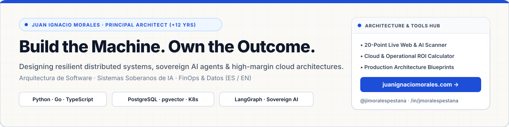

  

 

  
  
  
  

---

### Principal Systems & AI Architect (+12 yrs) · Anti-WAF Data Pipelines, `<15ms` Go Engines & PostgreSQL HA

> **"Build the Machine. Own the Outcome."**  
> *Designing fault-tolerant extraction engines, high-concurrency Go/Python backends, and High-Availability PostgreSQL architectures deployed inside your private cloud (`VPC`).*

I partner with data-intensive startups, B2B SaaS teams, and engineering agencies to eliminate **Cloudflare/Akamai scraping blackouts**, replace slow legacy backends with **sub-15ms Go & Python AsyncIO microservices**, and cut **AWS & residential proxy spend by 40%–60%**.

---

### ⚙️ Core Production Engineering Pillars

| Domain | Production Outcome | Core Stack & Battle-Tested Patterns |
| :--- | :--- | :--- |
| **01 · Tiered Anti-WAF & Self-Healing Extraction** | `>99.2%` continuous extraction uptime while cutting headless Chromium & proxy burn by `~60%`. | `Python AsyncIO` · `curl_cffi` · `selectolax` · `Playwright / Camoufox` · `Redis Identity Forge` · `LangGraph Self-Healing` · `pg_trgm + RapidFuzz` |
| **02 · High-Concurrency Go & Distributed Backends** | Sub-15ms in-memory phonetic/fuzzy screening (`-70%` RAM vs. Python/Oracle) & outage-proof APIs. | `Go (Golang / Gin)` · `FastAPI` · `Prefix Tries` · `Circuit Breakers` · `Bulkheads (K8s / KEDA Spot)` · `Monadic Result Pattern` · `DLQ` |
| **03 · High-Availability PostgreSQL & Cloud FinOps** | Consolidating `$8,500+/mo` fragmented cloud sprawl into lean HA topologies (`-45%` p95 latency). | `PostgreSQL 16/18 HA` · `Streaming Replication` · `pgvector + BM25` · `Idempotent Micro-Batching` · `Change Data Capture (CDC)` |

---

### 📦 Featured Reference Architectures & Open Blueprints

- 🛡️ **[`tiered-antiwaf-selfhealing-blueprint`](https://github.com/jmoralespestana/tiered-antiwaf-selfhealing-blueprint)** — Reference **Python 3.12+ AsyncIO** extraction engine implementing Monadic `Result` escalation (`Tier-0.5 <800ms HTTP` $\rightarrow$ single-flight `WAF Identity Forge` cookie reuse $\rightarrow$ `Stealth Browser` fallback) + sandboxed LLM DOM-selector self-healing without redeployments.
- 🎙️ **[`ghl-voice-ai-crm-concierge`](https://github.com/jmoralespestana/ghl-voice-ai-crm-concierge)** — Production **FastAPI + GoHighLevel (`GHL`) API v2** receptionist & CRM concierge featuring Dual Voice AI (`Gemini Live` WebSocket + `Retell AI` `HMAC-SHA256`), bidirectional **Human-In-The-Loop (`HITL`)** staff takeover switches, SQLite `WAL` zero-loss Dual-Write, and `BIGINT` integer-cent financial guardrails.
- 🧠 **[`orders-rag-basic`](https://github.com/jmoralespestana/orders-rag-basic)** — Production **PostgreSQL 18 + Python 3.14 (`UUIDv7`)** deterministic NL2SQL & Hybrid RAG architecture featuring AST-level SQL validation (`sqlglot`), strict read-only RBAC, integer minor-unit ledger safety, and reprocessable `DLQ`.
- 📐 **[Ungated Anti-WAF Architecture Breakdown + 24h Blocked-URL Proof](https://juanignaciomorales.com/en/anti-waf-pipeline?el=gh-jmoralespestana-profile-readme-antiwaf-v1&utm_source=github&utm_medium=profile_readme&utm_campaign=github_profile)** — Full 5-layer architecture walkthrough and zero-risk 24-hour benchmark on your hardest target URL.
- 📊 **[Cloud FinOps & Operational Risk ROI Calculator](https://juanignaciomorales.com/en/tools/oaas-roi-calculator?el=gh-jmoralespestana-profile-readme-roi-calculator-v1&utm_source=github&utm_medium=profile_readme&utm_campaign=github_profile)** — Quantify annual margin leakage from oversized cloud clusters, proxy sprawl, and unplanned incidents.

---

### 📺 Architecture Breakdowns on YouTube (`@jimoralespestana`)

- ▶ **[Anatomy of a $50k/Hour Production Outage & How Resilience Patterns Prevent It](https://www.youtube.com/@jimoralespestana)** (`YTB-V-0001`)
- ▶ **[The Modern Data Stack Explained: Medallion Lakehouse Architecture in Production](https://www.youtube.com/@jimoralespestana)** (`YTB-V-0020`)

---

### 🤝 Sprints, White-Label Architecture & Direct Contact

- ⚡ **24-Hour Blocked-URL Proof & Architecture Sprints**: [juanignaciomorales.com/en/anti-waf-pipeline](https://juanignaciomorales.com/en/anti-waf-pipeline?utm_source=github&utm_medium=profile_footer)
- 🩺 **Executive Architecture Diagnostic**: [juanignaciomorales.com/en/diagnostic](https://juanignaciomorales.com/en/diagnostic?utm_source=github&utm_medium=profile_footer)
- ✉️ **Direct Engineering Contact**: `juan@juanignaciomorales.com` · [LinkedIn `/in/jimoralespestana`](https://www.linkedin.com/in/jimoralespestana/)
