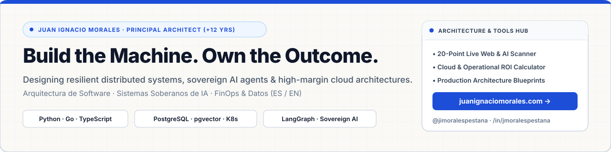

  

 

  
  
  
  

---

### Principal Software & AI Systems Architect (+12 yrs) · Fractional CTO & Executive Advisor

> **"Build the Machine. Own the Outcome."**  
> *Construye la máquina. Adueñate del resultado. — Sistemas resilientes e IA soberana sin entropía operativa.*

I design and deploy **high-availability distributed systems**, **sovereign multi-agent AI architectures**, and **high-margin data/cloud foundations** for B2B engineering and executive teams. Instead of fragile demos or bloated SaaS sprawl, I focus on deterministic production systems deployed inside the client's own cloud (`VPC`) with measurable P&L and latency guarantees.

---

### ⚙️ Core Engineering & Architecture Pillars

| Domain | Production Focus | Core Stack & Patterns |
| :--- | :--- | :--- |
| **01 · Distributed Systems & Resilience** | Eliminating cascading outages, race conditions, and single points of failure under high load. | `Go` · `Python (FastAPI/Async)` · `Kubernetes` · `Circuit Breaker` · `Transactional Outbox` · `Idempotency` · `DLQ` |
| **02 · Sovereign AI & Agentic Systems** | Deterministic 3-layer agentic orchestration (`SOPs -> Skills -> Playbooks`) & hybrid enterprise retrieval without vendor lock-in. | `LangGraph` · `PydanticAI` · `PostgreSQL 16` · `pgvector + BM25 RRF` · `MCP / WebMCP` · `Strict RBAC` |
| **03 · Data Platforms & Cloud FinOps** | Replacing `$8,500+/mo` fragmented SaaS/cloud bills with lean, high-throughput Medallion Lakehouse & sovereign infrastructure. | `Medallion Architecture` · `dbt` · `DuckDB / BigQuery` · `Redis Streams` · `OpenTelemetry` · `Cloud FinOps` |

---

### 🛠️ Live Interactive Engineering Tools & Production Blueprints (`$0`)

Explore our open diagnostic calculators and architectural blueprints directly on **[juanignaciomorales.com](https://juanignaciomorales.com?utm_source=github&utm_medium=profile_body)**:

- 🔍 **[20-Point Live Website & AI Search Auditor](https://juanignaciomorales.com/en/tools/ai-web-auditor?el=gh-jmoralespestana-profile-readme-ai-web-auditor-v1&utm_source=github&utm_medium=profile_readme&utm_campaign=github_profile)** — Automated real-time HTTP scanner evaluating executive clarity, B2B conversion, `JSON-LD`, `robots.txt` AI crawler permissions, `/llms.txt`, and `/.well-known/mcp.json`.
- 📊 **[Cloud & Operational Risk ROI Calculator](https://juanignaciomorales.com/en/tools/oaas-roi-calculator?el=gh-jmoralespestana-profile-readme-roi-calculator-v1&utm_source=github&utm_medium=profile_readme&utm_campaign=github_profile)** — Quantify the exact annual financial leakage caused by manual glue-code, unplanned downtime, and oversized cloud bills.
- 📐 **[Production Stack Blueprint (`$320/mo` vs. `$8,500/mo`)](https://juanignaciomorales.com/en/resources/lm-0001-production-stack-blueprint?el=gh-jmoralespestana-profile-readme-lm0001-v1&utm_source=github&utm_medium=profile_readme&utm_campaign=github_profile)** — Reference topology using PostgreSQL 16 (`pgvector` + `pg_search` BM25) + Redis Streams + FastAPI/Go workers.
- 🛡️ **[Atlas of 12 Production Resilience Patterns](https://juanignaciomorales.com/en/resources/lm-0006-resilience-patterns-atlas?el=gh-jmoralespestana-profile-readme-lm0006-v1&utm_source=github&utm_medium=profile_readme&utm_campaign=github_profile)** — Implementation guide for Circuit Breakers, Bulkheads, Saga/Outbox, Rate Limiting, and Chaos Testing.

---

### 📺 Latest Published Architecture Breakdowns on YouTube (`@jimoralespestana`)

- ▶ **[Anatomy of a $50k/Hour Production Outage & How Resilience Patterns Prevent It](https://www.youtube.com/@jimoralespestana)** (`YTB-V-0001`)
- ▶ **[The Modern Data Stack Explained: Medallion Lakehouse Architecture in Production](https://www.youtube.com/@jimoralespestana)** (`YTB-V-0020`)

---

### 🤝 Executive Advisory & Contact

- 🌐 **Executive Diagnostic & Advisory (ES / EN / PT)**: [juanignaciomorales.com/en/diagnostic](https://juanignaciomorales.com/en/diagnostic?utm_source=github&utm_medium=profile_footer)
- ✉️ **Weekly 3-Minute Dispatch (*The Architect's Dispatch / El Despacho del Arquitecto*)**: [juanignaciomorales.com/en/newsletter](https://juanignaciomorales.com/en/newsletter?utm_source=github&utm_medium=profile_footer)
- 💼 **LinkedIn**: [linkedin.com/in/jimoralespestana](https://www.linkedin.com/in/jimoralespestana/)
